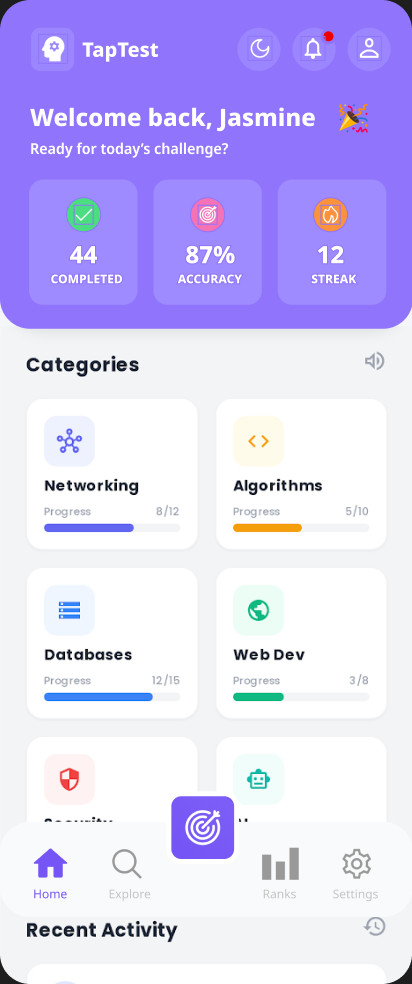
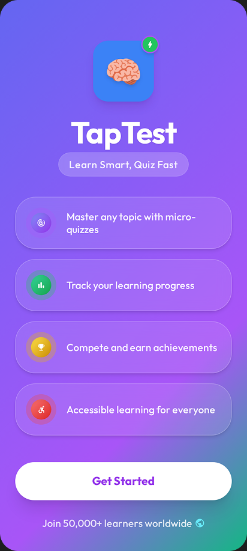
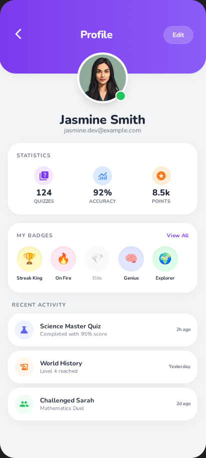
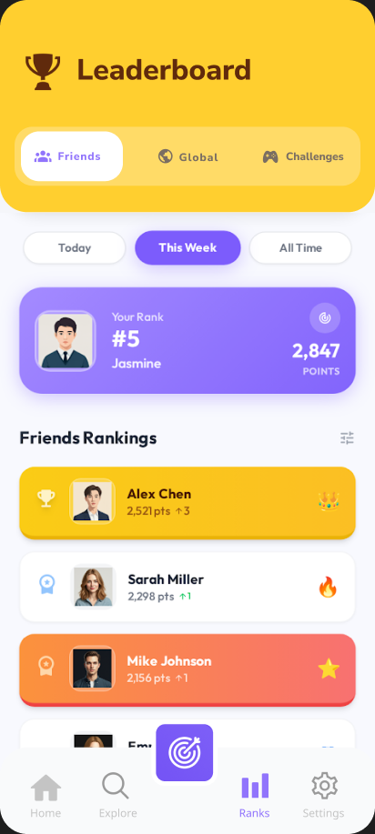
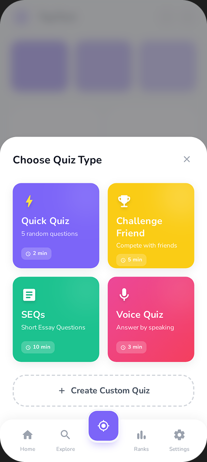
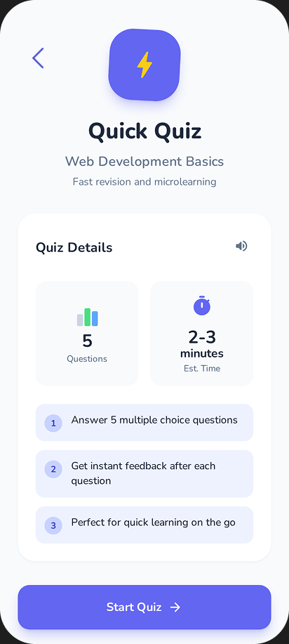
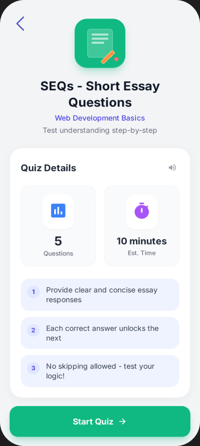
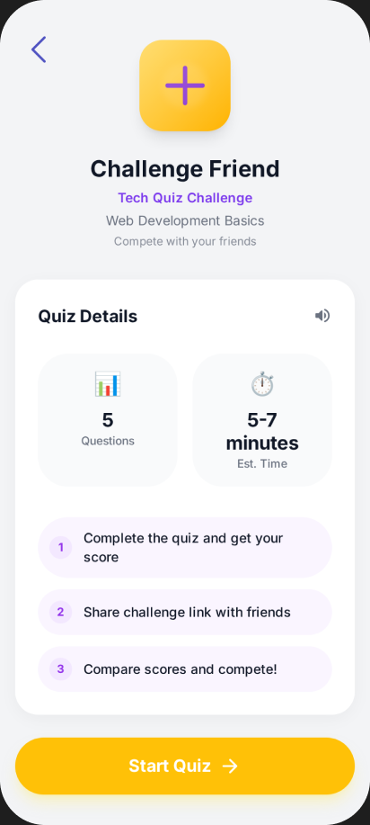
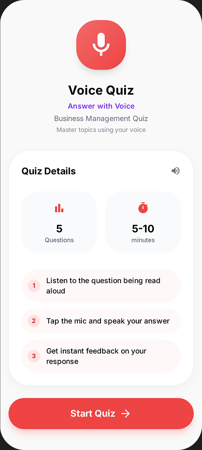

# 📱 TapTest – Mobile-First Micro-Quiz Application

<p align="center">
  <strong>A Human-Computer Interaction Project Focused on Designing an Accessible, User-Centered Micro-Quiz Application Using Figma</strong>
</p>

<p align="center">
  
  
  
  <br>
  
  
  
  
</p>

---

## 📌 Project Overview

TapTest is a mobile-first micro-quiz application concept developed as an academic Human-Computer Interaction (HCI) project. It aims to make learning more flexible and engaging through short, interactive quiz experiences.

The proposed application features Quick Quizzes, Structured Essay Questions (SEQs), Voice Quizzes, and **Challenge Chain Mode**, alongside gamification elements such as progress tracking, achievement badges, and leaderboards. Accessibility considerations include voice interaction, adjustable text sizes, high-contrast themes, and simplified navigation.

Designed using **Figma**, the project demonstrates the application of HCI principles through user-centered interface design, usability, and accessibility considerations.

**Project Scope:** This repository contains UI/UX design materials and academic documentation, not a fully developed or deployable mobile application.

---

## 🎯 Project Objectives

The primary objectives of this project are to:

- Design a mobile-first micro-quiz application that supports flexible learning.
- Provide different quiz experiences for various learning and interaction preferences.
- Introduce short and focused quiz activities to support microlearning.
- Design a social challenge experience through the proposed Challenge Chain Mode.
- Incorporate gamification elements to encourage learning engagement.
- Explore accessible interaction methods, including voice-based interaction.
- Consider users with different accessibility and usability requirements.
- Establish consistent navigation and visual elements throughout the application.
- Apply HCI principles to improve usability, accessibility, and user experience.
- Develop high-fidelity interfaces representing the proposed application features.

---

## 🧭 Design Approach & Principles

The project follows a user-centered design approach, considering usability, accessibility, and user interaction throughout the proposed application experience.

The interface design incorporates the following principles:

| Design Principle | Application in TapTest |
|---|---|
| Simplicity | Presents quiz activities and application features through clear and straightforward interfaces. |
| Consistency | Maintains consistent layouts, visual elements, and navigation patterns across screens. |
| Accessibility | Explores adjustable text sizes, high-contrast themes, voice interaction, and accessible touch targets. |
| User Control | Provides users with options to navigate, configure settings, and select quiz experiences. |
| Feedback | Uses visual, audio, and haptic feedback concepts to communicate interface responses. |
| Reduced Cognitive Load | Uses focused question layouts, clear language, and progress indicators to simplify interactions. |

---

## 🚀 Proposed Application Features

### 1. Quick Quiz

A short quiz experience designed around focused questions, allowing users to participate in quick learning activities.

### 2. Structured Essay Questions (SEQs)

A quiz format designed to support structured, descriptive answers rather than relying exclusively on multiple-choice questions.

### 3. Challenge Chain Mode

A social quiz experience that allows users to create and share challenges through a link or code. Other users can attempt the same challenge asynchronously, with their results presented on a shared leaderboard.

### 4. Voice Quiz

A proposed voice-based quiz experience that explores voice input and output to support alternative interaction methods.

### 5. Gamification & Progress Tracking

Includes proposed engagement features such as:

- Learning progress tracking.
- Leaderboards.
- Achievement badges.
- Quiz performance indicators.

### 6. Accessibility & Inclusive Interaction

The proposed interface explores accessibility-oriented features such as:

- Voice input and output.
- High-contrast themes.
- Adjustable text sizes.
- Haptic feedback.
- Large touch targets.
- Simplified gestures and navigation.
- Screen reader compatibility.
- Visual, audio, and haptic feedback.
- Clear language and progress indicators.

### 7. Topic Workspace & Learning Resources

Provides a proposed workspace for organizing learning topics and supporting resources, including PDFs, notes, and external links.

---

## 🛠️ Technologies & Tools

| Category | Technologies / Tools |
|---|---|
| Primary Design Tool | Figma |
| UI/UX Design | User-Centered Design |
| Interface Planning | Mobile Interface Design |
| Visual Design | High-Fidelity UI Design |
| Prototyping | Figma Prototyping |
| Design Principles | Human-Computer Interaction |
| Design Focus | Accessibility, Usability, Microlearning |
| Documentation | Markdown, GitHub |

---

## 📱 Application Preview

The following preview showcases the main dashboard of the proposed TapTest mobile application.

<p align="center">
  <a href="https://raw.githubusercontent.com/Jasmine10447/TapTest-Mobile-App-UI/main/public/images/taptest/Main%20Dashboard%20Screen.png">
    
  </a>
</p>

<p align="center">
  <em>TapTest – Main Dashboard Interface</em>
</p>

---

## 🖼️ Application Screens

Explore the other interface designs created for the proposed TapTest application. Select any screen to view its full-size version.

<table>
  <tr>
    <td align="center" width="50%">
      <a href="https://raw.githubusercontent.com/Jasmine10447/TapTest-Mobile-App-UI/main/public/images/taptest/TapTest%20Landing%20Screen.png">
        
      </a>
      <br>
      <strong>Landing Screen</strong>
    </td>
    <td align="center" width="50%">
      <a href="https://raw.githubusercontent.com/Jasmine10447/TapTest-Mobile-App-UI/main/public/images/taptest/Profile%20Screen.png">
        
      </a>
      <br>
      <strong>Profile Screen</strong>
    </td>
  </tr>
  <tr>
    <td align="center" width="50%">
      <a href="https://raw.githubusercontent.com/Jasmine10447/TapTest-Mobile-App-UI/main/public/images/taptest/Leaderboard%20Screen.png">
        
      </a>
      <br>
      <strong>Leaderboard Screen</strong>
    </td>
    <td align="center" width="50%">
      <a href="https://raw.githubusercontent.com/Jasmine10447/TapTest-Mobile-App-UI/main/public/images/taptest/Quiz%20Selection%20Screen.png">
        
      </a>
      <br>
      <strong>Quiz Selection Screen</strong>
    </td>
  </tr>
  <tr>
    <td align="center" width="50%">
      <a href="https://raw.githubusercontent.com/Jasmine10447/TapTest-Mobile-App-UI/main/public/images/taptest/Quick%20Quiz%20-%20Detail%20Screen.png">
        
      </a>
      <br>
      <strong>Quick Quiz – Detail Screen</strong>
    </td>
    <td align="center" width="50%">
      <a href="https://raw.githubusercontent.com/Jasmine10447/TapTest-Mobile-App-UI/main/public/images/taptest/SEQ%20Detail%20Screen.png">
        
      </a>
      <br>
      <strong>SEQ – Detail Screen</strong>
    </td>
  </tr>
  <tr>
    <td align="center" width="50%">
      <a href="https://raw.githubusercontent.com/Jasmine10447/TapTest-Mobile-App-UI/main/public/images/taptest/Challenge%20Chain%20-%20Detail%20Screen.png">
        
      </a>
      <br>
      <strong>Challenge Chain – Detail Screen</strong>
    </td>
    <td align="center" width="50%">
      <a href="https://raw.githubusercontent.com/Jasmine10447/TapTest-Mobile-App-UI/main/public/images/taptest/Voice%20Quiz%20Detail%20Screen.png">
        
      </a>
      <br>
      <strong>Voice Quiz – Detail Screen</strong>
    </td>
  </tr>
</table>

---

## 📂 Repository Structure

The repository is organized into separate directories to maintain the final interface designs, exported application screenshots, and supporting academic documentation.

```text
TapTest-Mobile-App-UI/
│
├── Final UI Designs/
│   └── Exported high-fidelity application screens
│
├── TapTest Report/
│   └── Final academic project report
│
├── public/
│   └── images/
│       └── taptest/
│           ├── Main Dashboard Screen.png
│           ├── TapTest Landing Screen.png
│           ├── Profile Screen.png
│           ├── Leaderboard Screen.png
│           ├── Quiz Selection Screen.png
│           ├── Quick Quiz - Detail Screen.png
│           ├── SEQ Detail Screen.png
│           ├── Challenge Chain - Detail Screen.png
│           └── Voice Quiz Detail Screen.png
│
├── LICENSE.txt
└── README.md
```

---

## 📖 Project Documentation

The final project report provides the academic background, design considerations, proposed application features, and supporting information behind the TapTest concept.

It documents the project's focus on microlearning, accessibility, gamification, and user-centered interaction design.

Refer to the **TapTest Report** folder for the supporting project report.

---

## 💡 Project Outcomes

The project provided practical experience in applying Human-Computer Interaction principles to the design of an educational mobile application.

Key outcomes included:

- Developed a mobile-first micro-quiz application concept.
- Designed multiple quiz experiences to support different learning and interaction preferences.
- Explored a social learning experience through the proposed Challenge Chain Mode.
- Incorporated gamification concepts to encourage participation and engagement.
- Considered accessibility requirements throughout the proposed interface designs.
- Created high-fidelity interfaces for the application's primary features.
- Explored user navigation, interaction patterns, and information organization.
- Documented the proposed application experience through a final academic project report.

---

## ⚠️ Project Scope & Limitations

- This repository contains UI/UX design materials and academic documentation rather than a fully implemented application.
- The application interfaces represent proposed functionality and do not demonstrate a working mobile application.
- Backend development, REST API integration, and database implementation are outside the scope of the completed design work.
- User authentication and account management are represented as interface designs rather than functional services.
- Quiz creation, question processing, scoring, and progress tracking are not implemented application features.
- Challenge Chain sharing and leaderboard functionality are design concepts and are not connected to a live service.
- Voice input and output are proposed interaction features and do not represent implemented voice-processing functionality.
- Accessibility features are considered in the interface design but have not been validated through a complete implementation or formal accessibility testing.
- AI-based adaptive learning, offline quiz functionality, instructor dashboards, and LMS integration are outside the project scope.

---

## 🎨 Figma Design File

<p align="center">
  <a href="https://www.figma.com/design/aZtNlUDsdEs3gIUQHCqwIW/TapTest-Mobile-App-UI?node-id=0-1&t=ZTpMvWu8op2tTAM1-1">
    
  </a>
</p>

---

## 🔒 Copyright & Usage Policy

### © 2026 Yesmin Jalaldeen. All Rights Reserved.

This repository showcases an original academic UI/UX design project developed by the author.

Original project contributions, including design concepts, interface arrangements, visual design decisions, and project-specific documentation, remain the intellectual property of the author unless otherwise stated.

Third-party images, icons, fonts, and other resources are not claimed as the author's original work and remain subject to their respective licensing and usage conditions.

Public availability of this repository does not grant permission to reproduce, redistribute, modify, or commercially use the original project materials without prior written permission.

---

## 📩 Permission & Attribution

For questions regarding the original design contributions, attribution, or permissions beyond the rights granted by the applicable terms of use, please contact the author.

<div align="center">

### ✍️ Yesmin Jalaldeen

*Project Author & UI/UX Designer*

**BIT (Hons) Specialized in Computer Networks**  
**BCS HEQ in Computer Networks**

*“Designing Accessible Learning Experiences Through Human-Centered Interaction.”*

**© 2026 Yesmin Jalaldeen — All Rights Reserved.**

</div>